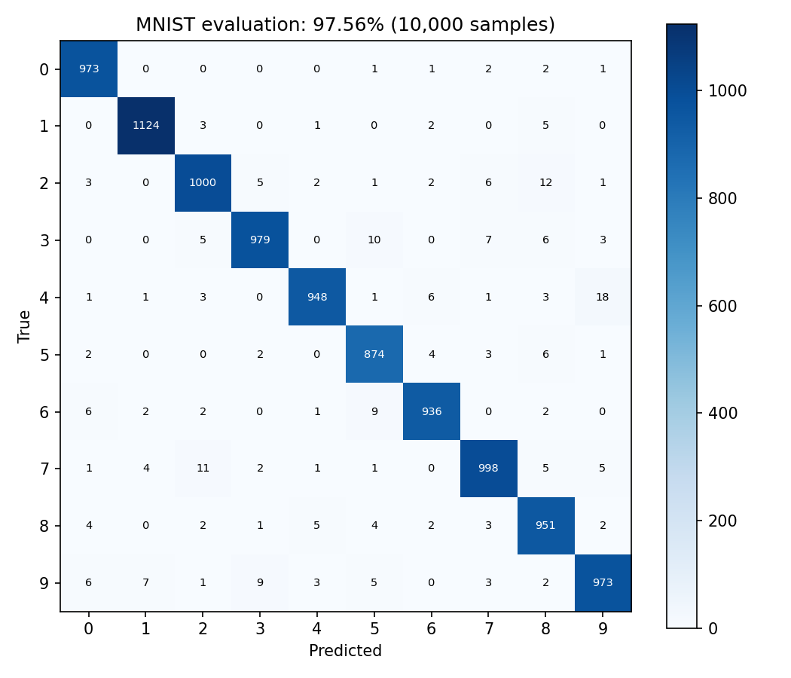

# D²NN MNIST: loss design, model size and physical-validation limits

[中文](README.md) | English

A PyTorch research project on phase-only diffractive neural networks for handwritten-digit classification. It combines scalar angular-spectrum propagation, trainable phase masks and circular detector regions, with experiments on loss functions, normalization and spatial resolution.

**Validation status (2026-10-12):** five supplied checkpoints were evaluated on all 10,000 MNIST test images. Their accuracies match the historical results below. Training was exercised on a small subset; full training from scratch and Lumerical FDTD reproduction have **not** been completed.

## Results

| Configuration | Historical accuracy | Checkpoint evaluation | Trainable phase parameters |
|---|---:|---:|---:|
| 5 layers, 200×200, one-hot MSE + sum normalization | 89.47% | **89.47%** | 200,000 |
| 5 layers, 200×200, contrast loss + sum normalization | 97.56% | **97.56%** | 200,000 |
| 5 layers, 100×100, contrast loss, ring radius 14 px | 97.30% | **97.30%** | 50,000 |
| 5 layers, 100×100, contrast loss, ring radius 20 px | 97.47% | **97.47%** | 50,000 |
| 5 layers, 100×100, image-wise Pixel-MSE | 91.20% | **91.20%** | 50,000 |

These are evaluations of existing weights, not independent retraining. The 200→100 comparison reduces phase parameters by **75%**, with a **0.26 percentage-point** difference for the 14-pixel-ring configuration. The thesis reports roughly 4× faster training; this timing claim has not been independently verified. Single-run evaluation times in the logs are not training-speed benchmarks.



See [the evidence ledger](docs/RESULTS.md) for source locations, discrepancies and limitations. Selected historical example images are in `assets/reported/`; newly generated evaluation matrices and machine-readable metrics are in `validation/`.

Browse the [figure gallery](docs/FIGURES.md) for verified confusion matrices and historical diagnostics.

## Quick start

Only four direct dependencies are declared: torch, torchvision, numpy and matplotlib. See [dependency details](docs/DEPENDENCIES.md) for their uses, transitive dependencies and tested versions. The requirements file is not a version lock.

Use Python 3.10 or newer. From the repository root, create an isolated environment and install a compatible PyTorch/torchvision pair for your hardware, then the remaining dependencies:

```bash
python -m venv .venv
# Windows PowerShell: .venv\Scripts\Activate.ps1
# macOS/Linux: source .venv/bin/activate
python -m pip install -r requirements.txt
python -m d2nn.cli smoke --config configs/current_56.json --device cpu --output runs/smoke
```

Evaluate the included 97.56% checkpoint:

```bash
python -m d2nn.cli evaluate --config configs/contrast_200.json --data-root data --download --output runs/contrast_200
```

The first dataset download requires internet access. Omit `--download` for a fully local run. Use `--device cpu` if a compatible GPU installation is unavailable. `--batch-size 16` reduces working memory. Every command requires a **new** output directory.

Train a new model using a reconstructed configuration:

```bash
python -m d2nn.cli train --config configs/contrast_100.json --data-root data --download --epochs 15 --output runs/new_training
python -m d2nn.cli evaluate --config runs/new_training/config.json --checkpoint runs/new_training/model.pt --data-root data --output runs/new_training_eval
python -m unittest discover -s tests -v
```

New training saves configuration, metrics, `history.csv`, confusion matrix, training curves and a checkpoint. Historical augmentation settings are incomplete; these commands do not promise the thesis accuracy. See [environment and reproduction instructions](docs/REPRODUCIBILITY.md).

## How the model works


The numerical core preserves the supplied implementation: orthonormal FFTs, 2× zero padding during propagation, cropping after each propagation, phase-only modulation and circular detector integration. Contrast loss uses a 0.1 margin on sum-normalized class scores; Pixel-MSE uses image-wise maximum-normalized intensity against the class mask. Supported CLI inputs are amplitude encoded. Historical phase-input variants are outside the scope of this public edition.

## Repository layout

```text
d2nn/                 Import-safe numerical core, CLI and plotting
configs/              Explicit evaluation and new-training configurations
checkpoints/          Five original checkpoints, renamed with hashes recorded
assets/reported/      Selected historical figures, unchanged
validation/           Actual checks, evaluation metrics and regenerated figures
tests/                Propagation, gradient and configuration-safety checks
docs/                 Evidence, provenance, environment and limitations
```

## FDTD and research limitations

FDTD validation was unsuccessful. The thesis's best quoted result of about 11% represents **1/9 diagnostic samples**, not a full MNIST evaluation. Different configurations and input encodings prevent a direct comparison with the 97.56% model. Missing helper modules and raw simulation records prevent a standalone FDTD rerun from this package. See [FDTD limitations](docs/FDTD_LIMITATIONS.md).

There are no multi-seed confidence intervals or fresh full-training reproductions. Historical test-set feedback was used during development, so this is not a new untouched holdout benchmark. Physical explanations in the thesis are research interpretations and should not be treated as uniquely proven by these small comparisons.

## Provenance

The numerical core was extracted without changing the original model definitions. Checkpoint and figure hashes are recorded in [provenance](docs/PROVENANCE.md). This public edition excludes datasets, duplicate historical scripts and incomplete FDTD code.

No open-source license has been assigned yet; dependency licenses remain applicable.

- [Reproduction guide in Chinese](docs/REPRODUCIBILITY.zh-CN.md)
- [Results and caveats in Chinese](docs/RESULTS.zh-CN.md)
- [FDTD limitations in Chinese](docs/FDTD_LIMITATIONS.zh-CN.md)
