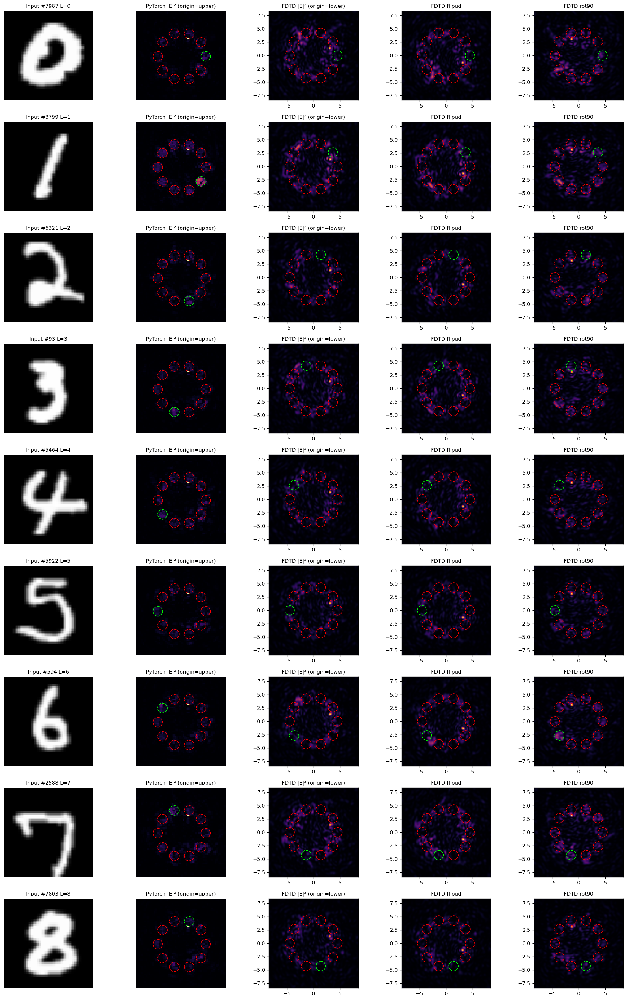

# FDTD 验证尝试与局限

[English](FDTD_LIMITATIONS.md) · [返回首页](../README.md)

**本项目未完成成功的 FDTD 物理验证。** 此次整理没有重新运行 Lumerical；公开版仅提供诊断说明和一张历史对比图，不包含依赖不完整的执行脚本。

## 原验证思路

从 PyTorch 导出 `π·tanh(raw_phase)`，将相位映射到介质高度，构造物理输入掩膜或注入复光场，再对比 FDTD 与 ASM 的探测器平面光强及类别读出。

原有辅助模块、完整仿真工程、材料/网格/边界/收敛记录未形成可独立运行的配套，因此无法仅凭本仓库复现这条链路。

## 历史结果

| 实验 | 主要设置或变化 | FDTD 结果 |
|---|---|---|
| 物理输入掩膜 | 56×56，0.3 μm 像素间距，532 nm，8.75 μm 层间距，2 层 | 0/8 |
| Imported Source | 改变输入注入方式，同时减少到 1 层 | 1/9 |
| 高折射率探索 | 折射率改为 8，改变高度范围，输入改为中心 10×10 | 1/9 |

“约 11%”实际是 **1/9 个诊断样本**，不是 MNIST 完整测试集表现。原代码包含挑选易分类样本的逻辑，样本选择偏差也需考虑。论文不同段落/配置还使用了约 95%、56%、40% 等不同的 PyTorch 比较值，不能合并成一个统一精度差。

## 不能从这些结果推出什么

标量 ASM、薄相位调制和亚波长介质几何的差异是值得检验的解释，但现有对比同时改变了输入、层数、折射率和输入分辨率，不能证明唯一失败原因。也不能据此声称所有工程问题均已排除，或 ASM 与 FDTD 在任何情形下都不兼容。

## 后续验证需要补齐

1. 固定同一组权重、输入样本、编码、波长、间距、层数和探测器位置，并保存配置与哈希。
2. 补全软件版本、材料、偏振、边界条件、空间网格与时间收敛记录。
3. 先验证无掩膜传播、均匀相位层及简单非均匀相位层，再尝试完整分类。
4. 用校准场确认坐标轴、转置、翻转和相位约定，不能依靠分类标签挑选最佳坐标变换。
5. 单独改变一个因素，预先固定样本及选择规则，同时报告场误差、光强误差和分类结果。
