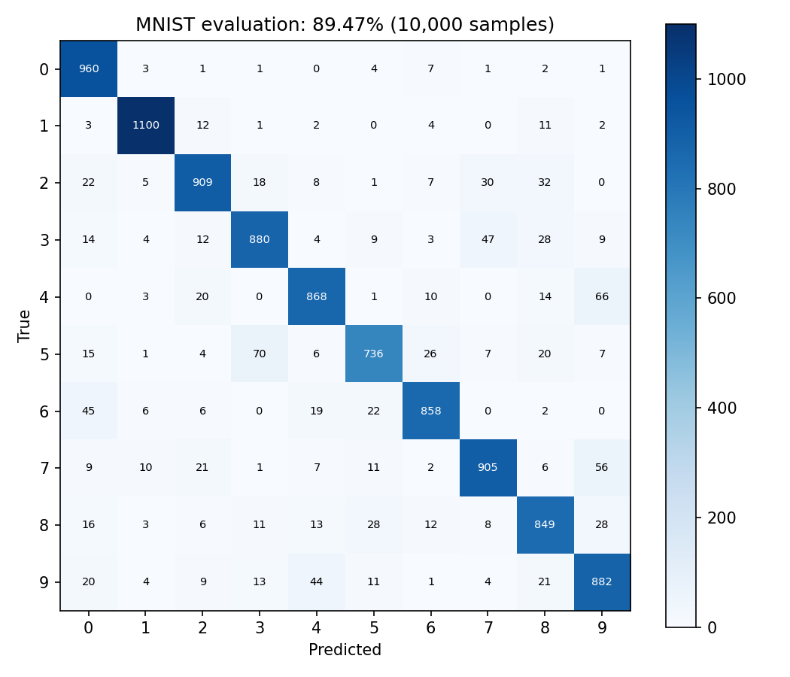
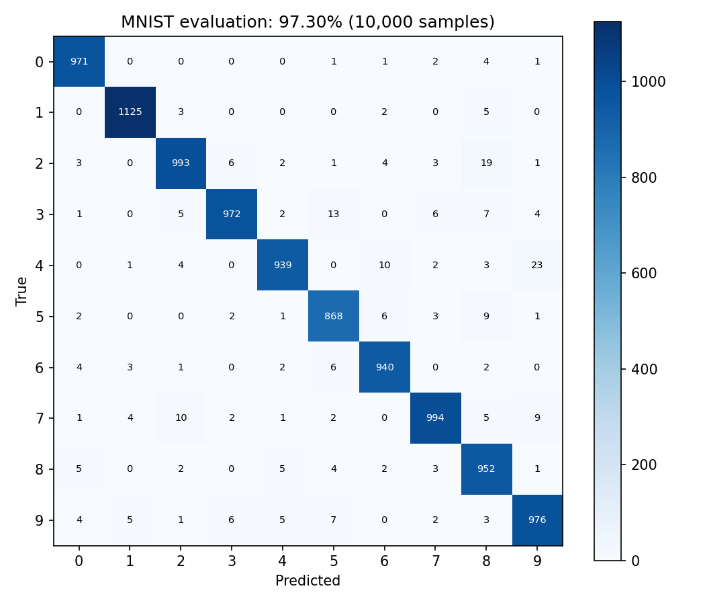
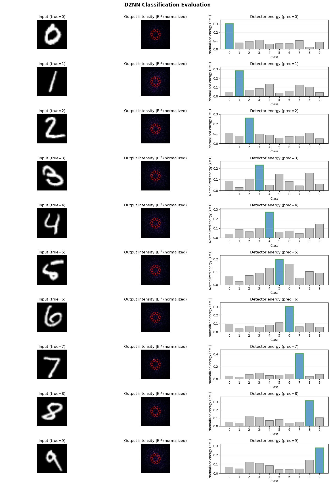

# 结果图集 / Figures

[返回首页](../README.md)

## 基线 / Baseline：89.47%

完整 10,000 张 MNIST 测试集重新评估生成。

## Contrast Loss + Sum：97.56%

完整测试集重新评估生成。

## 100×100 相位网格 / Smaller model：97.30%

可训练参数为 50,000。压缩同时改变了口径和探测器几何，详见结果文档。

## 历史样本图 / Historical examples

以下图片来自原实验材料，本次未重新生成，不代替完整测试集指标。

本版不展示小样本功能检查的训练曲线；历史主实验曲线未找到。新训练命令可生成真实逐轮日志和曲线。
